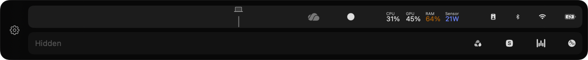

# Perch

A light menu bar manager for macOS. Perch hides the menu bar icons you don't need and brings them back with one click, without slowing your Mac down.

> Early development, for macOS 26 (Tahoe). See [docs/FEATURES.md](docs/FEATURES.md) for what's built.



## What it does

- **Click empty menu bar space for Perch's bar.** Every icon that's hidden or doesn't fit drops down in a small dark bar under the menu bar, easy to see over any window. Click one and its menu opens right there, like any menu, with Perch's bar still showing. Nothing moves in the menu bar (if an app's menu can't be copied, Perch shows its icons for a moment instead). Perch adds nothing to your bar unless you want it to: a thin line or an icon are options in Settings.
- **Put every icon where you want it.** Arrange shows your menu bar as one strip: hidden icons dimmed left of a line, the menu bar's icons to its right, in order. Drag an icon anywhere, or drag the line, and Perch moves the real icons. Order is priority: when the bar is full, icons on the left wait in Hidden until there's room. Arrange opens under the menu bar, or over it if you prefer (Settings).
- **Fits your screen.** On a laptop, icons that would land behind the notch go to Perch's bar instead, in your order. When a Live Activity shows up or grows, Perch makes room right away by moving the leftmost icon to Perch's bar. macOS places Live Activities itself, so Arrange shows them pinned at the left end.
- **Exact pictures (optional).** Perch's bar shows app icons, or with Screen Recording (in Settings), the icons exactly as they look.
- **Spotlight.** Every menu bar icon (except Live Activities) shows up in Spotlight. Type its name and press Return to open its menu, even when it's hidden.
- **Shortcuts.** Show Hidden Icons, Arrange Menu Bar and Open Menu Bar Icon actions.
- **Tighter spacing.** A slider fits more icons in the same bar.
- **Launch at login.**

Perch uses about 15 MB of memory and no CPU while idle. It reacts to events and never polls. It needs Accessibility to see and open icons; Screen Recording only for exact pictures.

## Using it

- **Click** empty menu bar space (or Perch's line or icon): Perch's bar.
- **Right-click** empty menu bar space: Arrange. Drag icons, or the line, to reorder and hide them. Its gear opens Settings; right-click it for Settings and Quit.
- **Spotlight**: "Arrange Menu Bar" opens Arrange too.
- **⌘Space**, then an icon's name: open that icon's menu.

On first launch, a short setup walks you through Accessibility and a few choices. Everything else is in the Guide (Settings → Guide), where you can jump to any topic.

## Build

Requires macOS 26 and Xcode 26. There's no download yet: build it from source.

```sh
./scripts/make-signing-cert.sh  # optional, once: keeps Accessibility across rebuilds
./scripts/build.sh              # builds build/Perch.app
./scripts/build.sh --install    # also copies it to /Applications and opens it
```

Or open `Perch.xcodeproj` and press Run. Without the signing certificate, builds are ad-hoc signed and macOS asks for Accessibility again after each rebuild.

If macOS won't open a copy of Perch built on another Mac, open System Settings → Privacy & Security and click Open Anyway.

## How it works

macOS has no API for hiding another app's menu bar icon. Perch adds a divider item and, when hiding, stretches it thousands of points wide. Everything to its left is pushed off the screen. Shrinking the divider brings them back.

Perch never touches your mouse. macOS keeps a saved position for every menu bar icon. To fit your screen, Perch moves only its own divider, which is instant. Hiding the leftmost icon, showing the rightmost hidden one, and reordering Perch's bar are instant too: only the divider moves, and Perch keeps its bar's order itself. Any other move needs the bar to reset: Perch saves new positions and restarts Control Center, which on macOS 26 draws every app's menu bar icons and places them when it starts. Apple's icons blink for a moment (and Focus shows its name again); your apps never restart. So it happens once, when you close Arrange, however many icons you moved. Sandboxed apps (Shottr, OneDrive) keep their settings where macOS asks before every change, so Perch moves the icons around theirs instead. If an icon doesn't land, Perch puts its saved spot back and says so the next time you open Arrange. Accessibility tells Perch where each icon is. A hidden icon sits off screen, so when Perch opens it, its menu opens off screen too. Perch reads that menu through Accessibility, closes it, and shows the same items as its own menu; picking one presses the real item. Icons that open a panel get the panel moved under Perch's bar.

## License

MIT. See [LICENSE](LICENSE).
